<div align="center">

# Hetang Mehta

Computer Engineering @ UAlberta · Lead Developer (co-op) @ CNRL · ML Team Lead @ Alberta BIONIX


[](https://www.hetangmehta.ca/)
[](https://www.linkedin.com/in/hetang-mehta/)

</div>

---

```console
hetang@calgary:~$ whoami
computer engineering student who ships production code and then writes the tests for it

hetang@calgary:~$ cat ./currently.txt
→ building Store Copilot, a Shopify admin app that answers merchants in plain English
→ leading ML for a powered prosthetic knee (the control loop has 10 ms. no pressure.)
→ wrapping up co-op term #3 as lead developer at CNRL

hetang@calgary:~$ cat ./off_screen.txt
→ hiking the Rockies, camera in hand
→ collecting passport stamps and trail photos

hetang@calgary:~$ cat ./philosophy.txt
LLMs plan. Deterministic code executes. Evals prove it. Vibes are not a test suite.
```

## 🎮 Current stats

<div align="center">

</div>

## 💼 Experience

<table>
<tr><td>

### 🛢️ Canadian Natural Resources (CNRL), Calgary
**Systems Developer Student · 3 co-op terms, 24 months**

**Term 3 · May–Dec 2026: the "you're the lead now" term**
- Took over as **lead developer** of a production capital-budgeting app (VB.NET, Oracle) when the previous lead moved teams, keeping a release every **3–4 weeks** and getting a new developer to production in **2 months**
- Cut asset loads from **90–160 → 5–20 minutes** by building an API import for 900+ assets per load, with version locks and a per-asset audit trail
- Sped up worst-case load time **81%** (117s → 22s) by profiling and moving a 59s step off the critical path
- Put every database object under version control after missed edits caused hotfixes. Found the gap in standups I started.

**Term 2 · Jan–Aug 2025: the "rebuild it properly" term**
- Rebuilt the economics engine after 4 years of tech debt, fixing outdated math and adding a new major-project level
- Cut release validation from **10 days of manual testing → 4 minutes** with 300+ automated tests
- Built a golden well-production database **and** the PWA portal for it (C#, Blazor), removing reconciliation work that ate **a third** of analysis time for 500+ engineers

**Term 1 · Jan–Aug 2024: the "learn the codebase" term**
- Reduced database tickets **33%** vs. the prior 24 months by redesigning Oracle schemas and tuning queries
- Shipped 15+ hotfixes and small features to production

</td></tr>
<tr><td>

### 🦿 Alberta BIONIX, Edmonton
**ML Team Lead · Sep 2025 – Present**
- Lead a 2-engineer ML team building control models for a powered prosthetic knee
- Cut model inputs from **24 → 7 features** while keeping **87%** accuracy, from a **26GB** EMG gait dataset
- Co-designed a **10 ms** on-leg control loop: swapped a CNN too big for the onboard chip for an LDA classifier, a small MLP and PID control
- Leading design of an RL tuner that adjusts PID gains each stride, so learned models never drive the motor directly

</td></tr>
<tr><td>

### ⚙️ Suncor Energy, Fort McMurray
**Data Analyst Intern · Sep–Dec 2023**
- Saved **30+ hours/week** and **$26K/year** with 3 Python automation tools for SAP workflows

</td></tr>
</table>

## 🛠️ Things I've built

| Project | What it does | Receipts 🧾 |
|---|---|---|
| 🛍️ **[Store Copilot](https://github.com/Killinwraith/ShopifyStoreCopilot)** | Embedded Shopify admin app that answers merchants' sales and inventory questions. The LLM fills a typed query plan; deterministic code executes it. | **29/30** evals · **0** hallucinated numbers · **1.8s** median latency |
| 🧠 **[Batch Normalization](https://github.com/Killinwraith/BatchNormalization-ReduceInternalCovariateShift)** | Reproduction of Ioffe & Szegedy (2015) in PyTorch on MNIST and CIFAR-10. | MNIST **73–84% → ~98%** · survived LR 0.1 while the baseline diverged |
| 🦿 **[EMG Viability Model](https://github.com/albertabionix/EMG_Viability_ML_Algorithm)** | Classifies prosthetic-trial candidate viability from EMG sensor data. | **26GB** dataset · Random Forest feature ranking |
| 🔎 **[RagApp](https://github.com/Killinwraith/RagApp)** | RAG from scratch, no LangChain, grounded in a local LLM. | ~**50 lines** of Python · NumPy cosine search |

## 🧰 Stack


## 🎲 Fun facts

- I've read more Oracle execution plans than novels this year
- I wrote 300 tests so nobody ever has to click through 10 days of UAT again. You're welcome, business team.
- My camera roll is 80% mountains, 20% screenshots of stack traces
- 日本語も話せます (yes, I speak Japanese)

<div align="center">
<sub>Made in Calgary · Powered by coffee, trail mix and well-typed query plans</sub>
</div>
